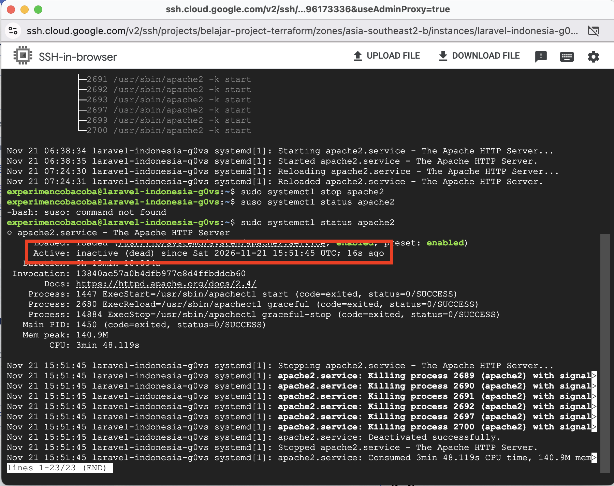
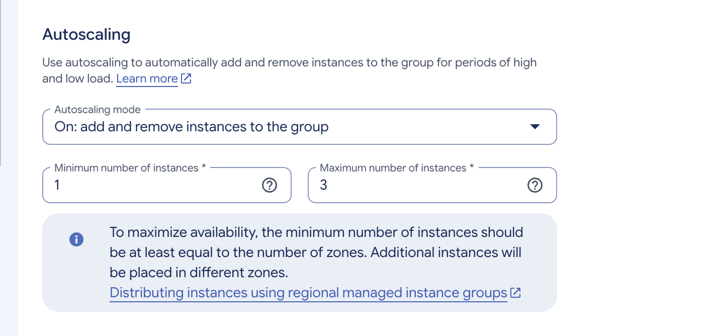

# Scalable Laravel Deployment on GCP (Terraform)

Deploy aplikasi Laravel di Google Cloud dengan arsitektur multi-region:
load balancer global, instance group dengan autoscaling di Jakarta dan
Singapura, Cloud SQL private IP, dan semua infrastruktur ditulis sebagai
kode dengan Terraform.

Aplikasi laravel filament yang biasanya dideploy di server tunggal, disini dideploy di banyak instance sekaligus, infrastruktur dibentuk agar bisa scaling secara automatis dengan bantuan  load balancer, instance group sebagai backend dengan dilengkapi auto scaller, dan healthcheck untuk melakukan inspeksi  kondisi tiap instance.

**Stack:** GCP, Terraform, Apache, PostgreSQL, Laravel

**Status:** Projek Belajar dan Portofolio

## Apa yang dibangun
- Global HTTP load balancer ke dua region (asia-southeast2 dan asia-southeast1)
- Managed instance group dengan autoscaling (CPU 60%) dan auto-healing
- Cloud SQL PostgreSQL dengan private IP (tanpa IP publik)
- VM tanpa IP publik, akses keluar lewat Cloud NAT, SSH lewat IAP
- Password database di Secret Manager, VM tanpa file key
- Terraform: seluruh stack bisa dibangun dan dihancurkan dengan satu perintah

## Alur trafik

**inbound:** trafic dari user masuk melalui ip public load balancer sebagai single entry point, traffic akan diarahkan ke backend terdekat dengan bantuan load balancer, di dalam load balancer trafic akan diproses, dan diteruskan ke instance yang tepat berdasarkan protocol, port dan url prefix ke instance yang tepat

**outbound:** vm instance tidak memiliki ip public sehingga outbound trafic akan ditangani oleh cloud NAT 

**akses database:** di dalam setiap instance terdapat cloud sql proxy, cloud sql proxy akan membentuk koneksi ke cloud sql instance melalui private ip, dan disini method yang digunakan adalah PSA (private service access), cloud sql proxy akan mengenkripsi setiap transaksi database yang menuju sql instance, aplikasi tidak menghubungi database secara langsung melainkan melalui cloud sql proxy pada ip 127.0.0.1, jadi seakan akan database nya berada di instance yang sama dengna aplikasi 

**storage:** vm instance mengakses cloud storage dan secret manager( tempat password ) melalui private google access

## Layanan yang dipakai
| Layanan | Fungsi | Alasan dipilih |
| :--- | :--- | :--- |
| VPC Network custom |Membangun virtual Lan | butuh kendali penuh terhadap jaringan infrastruktur |
| Cloud NAT | sebagai pintu outbound ke internet | instance tidak memiliki ip public, oleh karena itu butuh NAT untuk melakukan outbound trafic ke luar |
| Cloud Firewall | mengatur perizinan lalu lintas trafic | memperkuat keamanan dengan hanya membuka port yang dibutuhkan saja, menerapkan least privilage |
| Cloud Storage | menyimpan data berbentuk object | aplikasi membutuhkan penyimpanan file |
| Cloud SQL | menyiimpan database | aplikasi membutuhkan operasi database, instance dibutuhkan untuk mengelola database |
| Secret Manager | menyimpan password | menerapkan keamanan password dengan tidak menyimpan password langsung di instance |
| Instance Template | untuk membuat blueprint instance | instance group butuh instance template sebagai acuan spesifikasi instance yang akan dibentuk ketika scale up dan down |
| Instance Group | berperan sebagai instance manager | untuk melakukan scaling secara automatis dibutuhkan instance group sebagai pengelola nya |
| IAM & Admin | mengontrol permission ke setiap resource | menerapkan least privilage dengan memberikan permission yang dibutuhkan saja, mempersempit skala permission |
| Load Balancer | mengelola trafik | load balancer dibutuhkan untuk mengatur trafik, mengarahkan trafik pengguna ke instance yang terdekat, membagi trafik secara automatis ke banyak instance |
| Health Check | sebagai indikator untuk load balancer dan instance group | membantu instance group untuk mengetahui kapan harus melakukan scaling dan membantu load balancer untuk memilih instance  yang sehat |

## Keamanan
- Service account khusus dengan role sempit (daftar role)
- Token Creator hanya untuk akun itu sendiri (signed URL)
- Firewall hanya mengizinkan health check dan IAP
- Rahasia di Secret Manager, tidak di image atau repo
- Transaksi database dienkripsi melalui cloud sql proxy, dan aplikasi tidak mengakases database secara langsung melainkan dijembatani oleh cloud sql proxy
- Instance vm tidak memiliki ip public, trafic outbound melalui cloud NAT

## Cara menjalankan
1. disk boot yang akan dipakai untuk membentuk image harus dibuat dulu.
2. bisa ambil dari disk yang sudah tersedia, atau buat terlebih dahulu dengan membuat 1 instance dan konfigurasikan aplikasi laravel sampai jalan, lalu disknya dipakai untuk membuat image
3. sesuaikan nama disknya di file compute-instance.tf di bagian `source_disk = "projects/belajar-project-terraform/zones/asia-southeast2-b/disks/laravel-model3"`
4. setelah itu jalankan `terraform init` sebagai inisiasi awal. 
5. jalankan `terraform plan`, untuk melihat perubahan apa saja yang akan terjadi
6. jalankan `terrform apply` lalu ketikan yes ketika muncul pilihan

## Pengujian: uji failover dan auto-healing.
<!-- Screenshot dan hasil: backend healthy, sesi tetap login antar region, -->

masing masing backend dalam keadaan healthy

### simulasi failover

awalnya backend terdekat dari saya adalah backend instance group Indonesia, lalu saya uji simulasi failover dengan mematikan web server di instance milik instance group laravel indonesia dan mengubah minimum instance nya menjadi 0 untuk mencegah instance group melakukan self healing. 

<!--  -->

health check mendeteksi adanya kegagalan pada instance di instance group indonesia, sehingga load balancer akan mengalihkan ke instance yang berada di singapura 

hasilnya web masih bisa diakses dan sesion login user di region sebelumnya tidak terhapus karena session dipindah ke database bukan di instance vm

### simulasi self healing

kemudian minimum instance nya saya ubah ke 1, artinya harus selalu ada 1 instance yang aktif dan sehat.

instance group akan melakukan self healing memulihkan instance nya sendiri secara automatis terhlihat disini healthcheck menunjukan instance dalam keaadaan sehat kembali

## Keputusan desain
Kenapa dua region, kenapa VPC custom, kenapa satu template per region,
kenapa private IP + PSA.

- penggunaan dua region berbeda mensimulasikan ketersediaan bagi pengguna di region yang berbeda sehingga pengguna di masing masing region akan diarahkan ke instance server terdekat sehingga latensi nya kecil, selain itu jika terjadi kerusakan misalnya akibat bencana di salah satu region, layanan aplikasi masih bisa berjalan
- penggunaan vpc custom karena vpc custom hanya membuka port atau jalur yang kita buka saja, pada awalnya semua jalur di vpc custom ditutup semua. vpc default dari gcp menyediakan jalur port yang lebih longgar. 
- penggunaan satu template per region dikarenakan penggunaan vpc custom dengan vpc subnet yang terikat dimasing masing region, sehingga instance template harus menggunakan subnet yang sesuai dengan region nya, berbeda hal nya ketika menggunakan vpc default yang mana subnetnya automatis sehingga location nya bisa di set global dan instance template cukup satu untuk semua region
- penggunaan ip private dengan koneksi private psa pada cloud sql instance untuk meningkatkan keamanaan, mempersempit jalur akses ke instance database dan menyediakan koneksi yang terenkripsi melalui jalur private

## Keterbatasan dan rencana perbaikan

- saat ini load balancer hanya menangani trafik protokol http saja, untuk menyediakan enkripsi ssl diperlukan domain name. perbaikan kedepan adalah menambah satu frontend yang menangani trafik https 
- saat ini pembuatan image masih mengandalkan disk yang harus dibuat dulu, sehingga user perlu membuat 1 instance lalu mengkonfigurasikannya sampai aplikasi nya berjalan lalu disk bootnya dijadikan image, kedepannya instance yang dijadikan untuk membuat disk boot akan dibuat melalui terraform juga. 

## Masalah yang dihadapi dan solusinya
- masalah ketika health check selalu gagal di awal pembentukan instance, dan ditemukan masalahnya path health check salah didefinisikan, ternyata laravel menyediakan url khusus healthcheck yang secara default diatur ke url /up, dan saya set path health checknya seperti ini "/"
- masalah aplikasi selalu gagal mengakses storage bucket, dan masalahnya adalah instance vm tidak mempunya akses untuk membuat token untuk dirinya sendiri, akses storage tanpa key membutuhkan semacam token autentikasi sementara. 
- masalah ketika pertamakali melalkukan konfigurasi cloud sql proxy, yang selalu gagal terhubung ke cloud sql instance, dan masalahnya adalah cloud sql proxy versi pertama sudah deprecated dan harus menggunakan versi 2
- masalah ketika instance vm tertolak untuk mengakses resource lain nya seperti google storage dan cloud sql, masalahnya adalah scope untuk mengakses resource lain belum ditambahkan, lalu untuk menyelesaikan nya scope diatur ke all scope, akan instance punya akses untuk mengakses semua resource
- maslaah ketika instance vm tidak diizinkan mengakses google storage, dan masalahnya adalah service account yang gigunakan tidak memiliki role read dan write, permission harus diatur di kedua pihak, di storage dengan menbambahkan principal dengan role yang tepat, begitu juga di sisi service account diberi role untuk mengakses cloud storage
-

## Estimasi biaya
masih kebingungan cara menghitung nya 