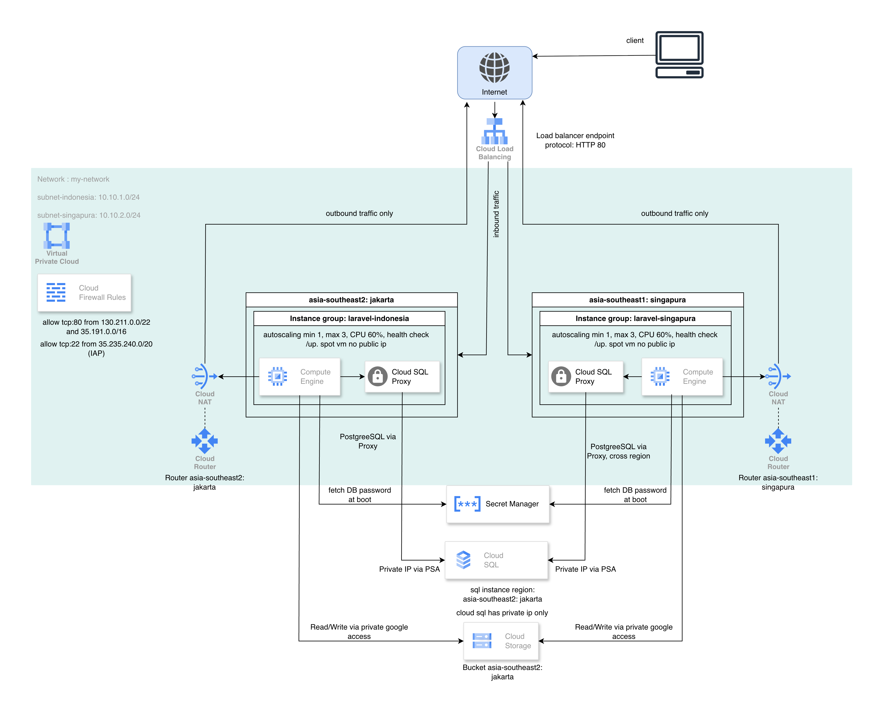
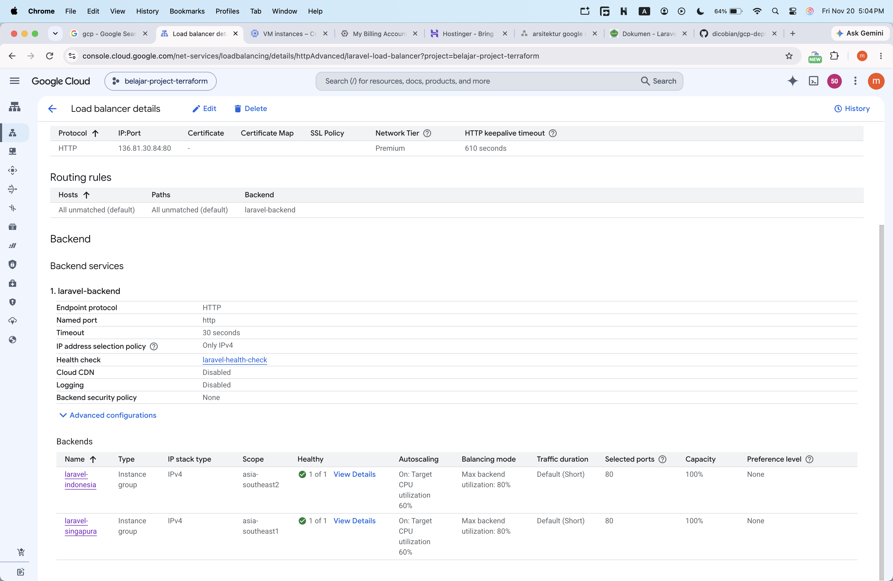
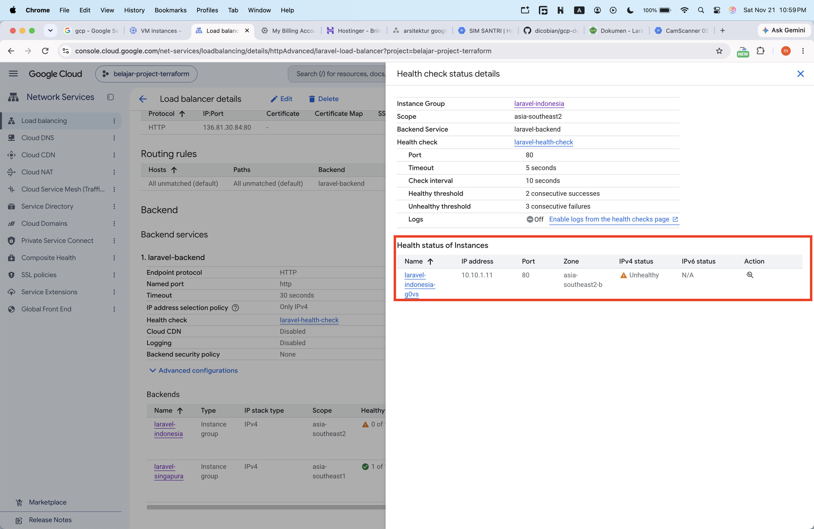
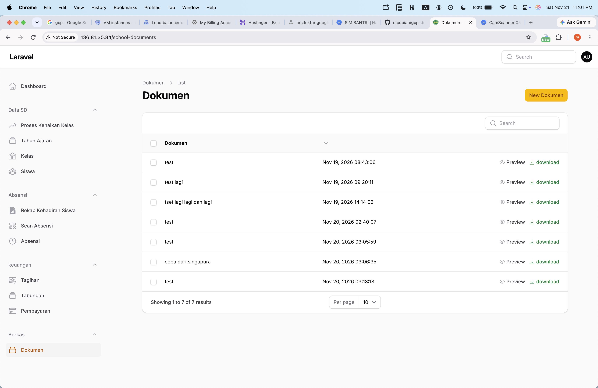
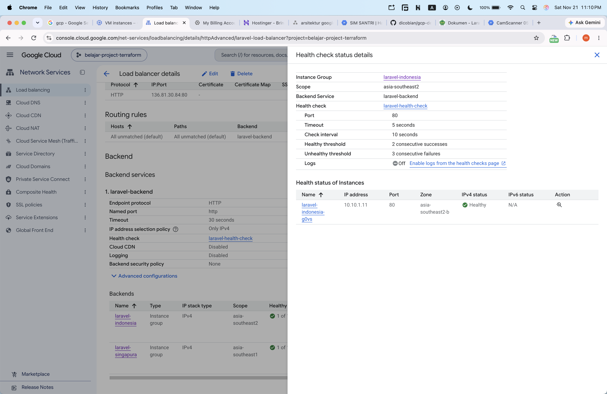
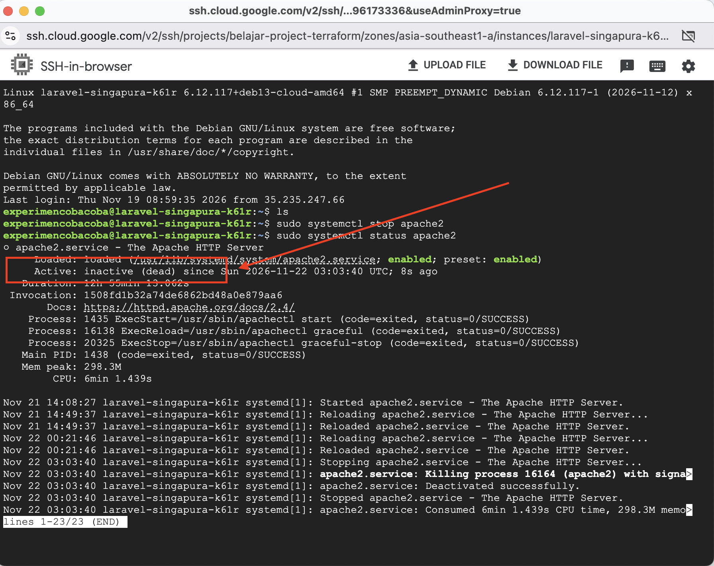
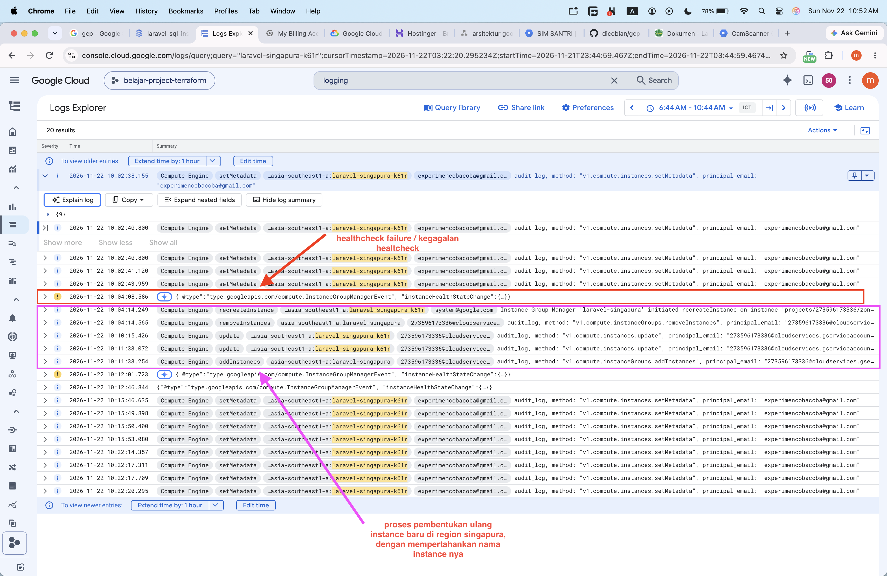

# Scalable Laravel Deployment on GCP (Terraform)

Aplikasi Laravel (Filament) yang biasanya dijalankan di satu server, di sini dijalankan di banyak VM sekaligus pada dua region Google Cloud (Jakarta dan Singapura). Trafik dibagi oleh load balancer global, jumlah VM menyesuaikan beban lewat autoscaling, health check memantau kondisi setiap VM, dan seluruh infrastrukturnya ditulis sebagai kode dengan Terraform.

**Stack:** GCP · Terraform · Laravel (Filament) · PostgreSQL · Apache

**Status:** proyek belajar dan portofolio, bukan konfigurasi produksi.



## Daftar isi

- [Apa yang dibangun](#apa-yang-dibangun)
- [Alur trafik](#alur-trafik)
- [Spesifikasi utama](#spesifikasi-utama)
- [Layanan yang dipakai](#layanan-yang-dipakai)
- [Keamanan](#keamanan)
- [Cara menjalankan](#cara-menjalankan)
- [Pengujian](#pengujian)
- [Keputusan desain](#keputusan-desain)
- [Keterbatasan dan rencana perbaikan](#keterbatasan-dan-rencana-perbaikan)
- [Masalah yang dihadapi dan solusinya](#masalah-yang-dihadapi-dan-solusinya)
- [Estimasi biaya](#estimasi-biaya)
- [Struktur repositori](#struktur-repositori)

## Apa yang dibangun

- Global HTTP load balancer yang melayani dua region (`asia-southeast2` Jakarta dan `asia-southeast1` Singapura)
- Managed instance group di setiap region dengan autoscaling (CPU 60%, minimum 1 dan maksimum 3 VM) dan auto-healing
- Cloud SQL PostgreSQL dengan private IP (tanpa IP publik)
- VM tanpa IP publik: akses keluar lewat Cloud NAT, akses SSH lewat IAP
- Password database disimpan di Secret Manager, VM tidak memakai file key
- Sesi pengguna disimpan di database, sehingga login tetap berlaku walau berpindah antar VM atau antar region
- Seluruh infrastruktur ditulis dengan Terraform dan bisa dibangun serta dihapus dengan `terraform apply` dan `terraform destroy`. Pengecualiannya adalah disk model untuk image, yang disiapkan manual (lihat [Cara menjalankan](#cara-menjalankan))

## Alur trafik

**Masuk (inbound).** Pengguna mengakses IP publik load balancer, satu-satunya pintu masuk ke sistem. Load balancer meneruskan trafik ke backend sehat yang paling dekat dengan pengguna, lalu ke salah satu VM di instance group backend tersebut. Kesehatan setiap VM ditentukan oleh health check pada path `/up`.

**Keluar (outbound).** VM tidak memiliki IP publik, sehingga trafik keluar ke internet (misalnya mengunduh paket) melewati Cloud NAT. Setiap region memiliki Cloud Router dan Cloud NAT sendiri.

**Akses database.** Di setiap VM berjalan Cloud SQL Proxy. Aplikasi tidak menghubungi database secara langsung, melainkan menyambung ke `127.0.0.1:5432`, seolah-olah database berada di VM yang sama. Proxy kemudian membentuk koneksi terenkripsi ke instance Cloud SQL lewat private IP memakai Private Service Access (PSA). Database berada di Jakarta, sehingga VM di Singapura mengaksesnya lintas region.

**Penyimpanan dan rahasia.** VM mengakses Cloud Storage (file unggahan) dan Secret Manager (password database) lewat Private Google Access, tanpa melewati internet publik. Saat boot, startup script mengambil password dari Secret Manager dan menuliskannya ke file `.env`.

## Spesifikasi utama

| Komponen | Konfigurasi |
| :--- | :--- |
| VPC | `my-network` (custom), subnet `subnet-indonesia` 10.10.1.0/24 dan `subnet-singapura` 10.10.2.0/24, Private Google Access aktif |
| VM | `e2-small`, Spot, disk 10 GB, tanpa IP publik |
| Autoscaling | Minimum 1, maksimum 3 VM per region, target CPU 60% |
| Health check | HTTP port 80, path `/up`, interval 10 detik, timeout 5 detik, sehat setelah 2 kali berhasil, tidak sehat setelah 3 kali gagal |
| Load balancer | Global external Application Load Balancer, HTTP port 80 |
| Database | Cloud SQL PostgreSQL 18, `db-f1-micro`, satu zona, SSD 10 GB, private IP saja |
| Bucket | Cloud Storage regional Jakarta, kelas Standard, akses publik dicegah |

## Layanan yang dipakai

| Layanan | Fungsi | Alasan dipilih |
| :--- | :--- | :--- |
| VPC Network (custom) | Jaringan virtual privat | Kendali penuh atas rentang IP, subnet, dan aturan jaringan |
| Cloud Firewall | Mengatur lalu lintas yang diizinkan | Hanya membuka port yang dibutuhkan (prinsip least privilege) |
| Cloud NAT dan Cloud Router | Jalur keluar ke internet | VM tanpa IP publik tetap bisa mengunduh paket |
| Cloud Storage | Menyimpan file unggahan | Semua VM berbagi satu penyimpanan, tidak ada file yang tertinggal di disk VM |
| Cloud SQL | Database PostgreSQL terkelola | Backup, patching, dan operasional database dikelola Google |
| Secret Manager | Menyimpan password database | Tidak ada password di image maupun repositori |
| Instance Template | Cetak biru VM (image, tipe mesin, jaringan, service account) | Instance group membutuhkannya untuk membuat VM baru saat scale up atau menggantikan VM yang rusak |
| Managed Instance Group | Mengelola sekumpulan VM | Menjaga jumlah VM, menjalankan rolling update, dan melakukan auto-healing |
| Autoscaler | Mengatur jumlah VM sesuai beban | Menambah VM saat CPU tinggi dan menguranginya saat beban turun |
| Health Check | Memeriksa apakah VM sehat | Load balancer berhenti mengirim trafik ke VM yang tidak sehat, dan instance group membuat ulang VM tersebut (auto-healing) |
| Load Balancer | Pintu masuk dan pembagi trafik | Satu IP untuk dua region, mengarahkan pengguna ke backend sehat terdekat |
| IAM | Mengatur izin tiap resource | Setiap izin dibatasi sesempit mungkin |

## Keamanan

- Service account khusus untuk VM (`laravel-vm-account`), tanpa role Editor
- VM tidak memiliki IP publik, dan trafik keluar melewati Cloud NAT
- Cloud SQL hanya memiliki private IP, tanpa IP publik
- Koneksi ke database dienkripsi oleh Cloud SQL Proxy
- Password database disimpan di Secret Manager, tidak ada di image maupun repositori
- VM tidak memakai file key: autentikasi lewat service account yang terpasang pada VM
- Bucket bersifat privat (`public_access_prevention = enforced`)
- SSH hanya lewat Identity-Aware Proxy (IAP)

**Izin IAM service account VM**

| Role | Dipasang di | Kegunaan |
| :--- | :--- | :--- |
| Cloud SQL Client | project | Menyambung ke instance Cloud SQL lewat proxy |
| Storage Object Admin | bucket aplikasi saja | Membaca, menulis, dan menghapus file di bucket |
| Secret Manager Secret Accessor | secret password database saja | Membaca password saat boot |
| Service Account Token Creator | service account itu sendiri | Membuat signed URL Cloud Storage tanpa file key |

VM memakai access scope `cloud-platform`, sehingga batas akses sebenarnya ditentukan oleh role IAM di atas.

**Aturan firewall**

| Tujuan | Sumber | Port | Target |
| :--- | :--- | :--- | :--- |
| Health check dan trafik load balancer | `130.211.0.0/22`, `35.191.0.0/16` | tcp:80 | tag `allow-health-check-laravel` |
| SSH lewat IAP | `35.235.240.0/20` | tcp:22 | tag `allow-ssh-iap` |

## Cara menjalankan

**Prasyarat**

- Terraform 1.6 atau lebih baru
- Google Cloud CLI (`gcloud`)
- Project GCP dengan billing aktif dan akun yang memiliki hak cukup (misalnya Owner di project belajar)

**1. Siapkan disk model untuk image (manual)**

Image VM dibuat dari sebuah disk yang sudah berisi aplikasi yang berjalan. Langkahnya:

1. Buat VM sementara dari image Debian (boleh di VPC `default` dengan IP publik sementara, karena yang dipakai nanti hanya disknya).
2. Pasang Apache, PHP, Composer, dan aplikasi Laravel, lalu pasang Cloud SQL Proxy versi 2 sebagai service systemd.
3. Pastikan aplikasi berjalan sendiri saat boot dan `http://localhost/up` mengembalikan respons sukses.
4. Kosongkan nilai rahasia di `.env`, supaya image tidak membawa password.
5. Hentikan VM. Disknya tetap ada dan siap dijadikan image.

Startup script pada instance template mengisi `DB_USERNAME`, `DB_PASSWORD`, `GOOGLE_CLOUD_PROJECT_ID`, dan `GOOGLE_CLOUD_STORAGE_BUCKET` di `.env`, memperbarui connection name pada service proxy, lalu me-restart layanan. Jalur aplikasi dan nama service di dalam image harus sesuai dengan yang dipakai skrip tersebut.

**2. Siapkan akses dan variabel**

```bash
gcloud auth application-default login
```

Buat file `terraform.tfvars` (file ini tidak di-commit):

```hcl
project_id = "ID-PROJECT-GCP-KAMU"
```

Variabel lain dapat dilihat di `variables.tf`.

**3. Sesuaikan nama disk**

Ubah `source_disk` pada resource image di file `compute-instance.tf` sesuai disk model milikmu:

```hcl
source_disk = "projects/PROJECT_ID/zones/asia-southeast2-b/disks/NAMA_DISK_MODEL"
```

**4. Jalankan Terraform**

```bash
terraform init      # mengunduh provider
terraform plan      # melihat apa yang akan dibuat
terraform apply     # ketik yes saat diminta
```

Beberapa catatan:

- Pembuatan Cloud SQL paling lama dan bisa memakan lebih dari 10 menit.
- Jika `apply` pertama gagal karena API baru diaktifkan, tunggu satu atau dua menit lalu jalankan `apply` lagi. Perintah ini aman diulang.
- Load balancer membutuhkan beberapa menit sampai siap. Selama itu respons `404` atau `502` masih normal.

**5. Jalankan migrasi database**

Database yang baru dibuat masih kosong. Setelah ada VM yang sehat, jalankan migrasi dari salah satu VM:

```bash
gcloud compute instances list --filter="name~laravel"
gcloud compute ssh NAMA_VM --zone=ZONA --tunnel-through-iap

cd /var/www/school-app
php artisan migrate --force
```

Jalankan juga seeder atau pembuatan akun admin awal jika diperlukan.

**6. Akses aplikasi**

```bash
terraform output -raw lb_ip
```

Buka `http://<IP-tersebut>` di browser.

**7. Hapus semua resource**

```bash
terraform destroy
```

> **Perhatian biaya:** load balancer, Cloud NAT, Cloud SQL, dan VM berbayar selama masih berjalan. Jalankan `terraform destroy` setelah selesai mencoba.
>
> Nama instance Cloud SQL yang sudah dihapus tidak bisa dipakai lagi dalam beberapa hari. Jika ingin membangun ulang, ubah namanya. Jika `destroy` gagal di koneksi private services, tunggu beberapa menit lalu jalankan lagi.

## Pengujian

Semua pengujian dilakukan lewat IP load balancer.

### Semua backend sehat

Kedua backend (Jakarta dan Singapura) berstatus healthy pada load balancer.



### Simulasi failover

Backend terdekat dari lokasi penguji adalah instance group Jakarta. Untuk menguji failover, web server (Apache) pada VM di instance group Jakarta dimatikan, dan jumlah minimum instance diturunkan menjadi 0 supaya grup tidak segera membuat ulang VM selama pengujian.


Health check mendeteksi kegagalan pada instance group Jakarta, sehingga load balancer mengalihkan trafik ke instance group Singapura.



Hasilnya, aplikasi tetap bisa diakses. Sesi login pengguna juga tetap berlaku karena sesi disimpan di database, bukan di disk VM.



### Pemulihan kapasitas oleh autoscaler

Jumlah minimum instance dikembalikan menjadi 1. Autoscaler membuat VM baru di instance group Jakarta sampai jumlah minimumnya terpenuhi.


Setelah VM baru selesai boot, health check menunjukkan instance kembali sehat dan backend Jakarta aktif lagi.



### simulasi self healing 

disini kita akan mencoba mematikan layanan apache pada instance di instance group singapura



kemudian kita check log nya, terlihat disini healthcheck mengalami kegagalan, lalu instance group mulai membuat instance baru dengan nama yang sama sebagai pengganti, dan menghapus instance lama




## Keputusan desain

| Keputusan | Alasan | Konsekuensi |
| :--- | :--- | :--- |
| Dua region | Pengguna dilayani backend terdekat sehingga latensi kecil, dan jika satu region bermasalah (misalnya bencana), aplikasi tetap berjalan di region lain | Database hanya di Jakarta, sehingga VM di Singapura mengakses database lintas region |
| VPC custom, bukan `default` | VPC custom dimulai dari kondisi tertutup dan hanya membuka jalur yang diizinkan, sedangkan VPC `default` menyediakan aturan firewall yang lebih longgar | Subnet bersifat regional dan semua resource jaringan harus ditulis sendiri |
| Satu instance template per region | Di VPC custom setiap subnet terikat pada satu region, dan template harus menunjuk subnet yang sesuai. Di VPC `default` subnet dibuat otomatis, sehingga satu template global cukup untuk semua region | Template dan instance group ditulis dua kali (satu per region) |
| Cloud SQL dengan private IP dan PSA | Database tidak terbuka ke internet dan koneksinya lewat jalur privat | Perlu rentang IP khusus dan koneksi peering ke jaringan layanan Google |
| Sesi disimpan di database | Pengguna tidak kehilangan sesi saat berpindah VM atau region | Menambah beban pada database |
| VM Spot | Biaya jauh lebih rendah untuk proyek belajar | VM bisa dihentikan Google sewaktu-waktu |
| Secret Manager untuk password | Password tidak tertanam di image atau repositori, dan mudah diganti | VM membutuhkan izin Secret Accessor dan jalur ke API Google |

## Keterbatasan dan rencana perbaikan

- **Hanya HTTP.** Load balancer baru menangani protokol HTTP karena belum ada nama domain. Rencana: mendaftarkan domain, memakai sertifikat terkelola, dan menambah frontend HTTPS.
- **Pembuatan image masih manual.** Disk model harus disiapkan dan dikonfigurasi dulu. Rencana: mengotomatiskan pembuatan image (misalnya dengan Packer) atau pipeline CI/CD.
- **VM Spot.** VM bisa dihentikan sewaktu-waktu sehingga aplikasi bisa terputus sebentar. Untuk produksi dipakai VM standar.
- **Database satu zona, tanpa HA dan backup.** Cloud SQL berjalan di satu zona dengan backup dimatikan. Rencana: konfigurasi HA dan backup otomatis.
- **Database hanya di Jakarta.** VM Singapura mengakses database lintas region. Rencana: read replica di Singapura.
- **Password ada di state Terraform.** Password dibuat oleh `random_password`, sehingga tersimpan di file state. Rencana: memindahkan state ke bucket GCS dengan akses terbatas.
- **Belum ada monitoring, alert, dan CI/CD.** Rencana: dashboard dan alert di Cloud Monitoring, serta pipeline untuk pengujian dan deploy otomatis.

## Masalah yang dihadapi dan solusinya

**1. Health check selalu gagal saat VM baru dibuat**
- *Gejala:* VM terus ditandai tidak sehat.
- *Penyebab:* path health check diatur ke `/`, padahal Laravel menyediakan endpoint khusus `/up`.
- *Solusi:* path health check diubah menjadi `/up`.

**2. Cloud SQL Proxy tidak bisa terhubung ke database**
- *Gejala:* proxy gagal terhubung dan koneksi dari aplikasi terputus.
- *Penyebab:* proxy versi pertama sudah deprecated sehingga harus memakai versi 2. Selain itu, setelah file service systemd diubah, `systemctl daemon-reload` belum dijalankan, sehingga proxy masih memakai connection name lama.
- *Solusi:* memakai Cloud SQL Proxy versi 2, lalu menjalankan `daemon-reload` dan me-restart proxy.

**3. Aplikasi tidak bisa mengakses Cloud Storage**
- *Gejala:* operasi file di bucket gagal.
- *Penyebab:* ada dua izin yang kurang. Pertama, service account belum memiliki role Storage di bucket. Kedua, pembuatan signed URL tanpa file key memerlukan izin Token Creator pada service account itu sendiri.
- *Solusi:* role Storage Object Admin dipasang di bucket, dan role Service Account Token Creator dipasang pada service account VM untuk dirinya sendiri.

**4. VM ditolak saat mengakses layanan Google lain**
- *Gejala:* permintaan ke Cloud Storage dan Cloud SQL ditolak.
- *Penyebab:* access scope VM belum mencakup API yang dibutuhkan.
- *Solusi:* scope diatur ke `cloud-platform`, dan pembatasan akses dilakukan lewat role IAM.

**5. Instance template selalu diganti pada setiap `terraform apply`**
- *Gejala:* `terraform plan` selalu menampilkan penggantian template (`forces replacement`) padahal kode tidak berubah.
- *Penyebab:* untuk VM Spot, GCP mengisi sendiri `instance_termination_action = "STOP"`, sedangkan nilai itu belum ditulis di kode, sehingga Terraform mendeteksi selisih.
- *Solusi:* menuliskan `instance_termination_action = "STOP"` secara eksplisit di blok `scheduling`.

**6. Cloud SQL private IP gagal dibuat**
- *Gejala:* error "the network doesn't have at least 1 private services connection".
- *Penyebab:* VPC belum memiliki koneksi private services, yang di console sering dibuat otomatis tetapi di Terraform harus ditulis sendiri.
- *Solusi:* menambahkan rentang IP (`google_compute_global_address`) dan koneksi (`google_service_networking_connection`), lalu membuat Cloud SQL bergantung pada koneksi tersebut.

**7. Secret Manager gagal dibuat**
- *Gejala:* error 403 `SERVICE_DISABLED`.
- *Penyebab:* API Secret Manager belum diaktifkan di project.
- *Solusi:* mengaktifkan API lewat Terraform (`google_project_service`) dan menambahkan `depends_on` pada resource yang membutuhkannya.


## Struktur repositori

```
.
├── README.md
├── providers.tf              # versi Terraform dan provider
├── variables.tf              # variabel input
├── apis.tf                   # pengaktifan API GCP
├── network.tf                # VPC, subnet, firewall, router, NAT, PSA
├── iam.tf                    # service account dan izin IAM
├── storage.tf                # bucket
├── database.tf               # Cloud SQL, database, user
├── secrets.tf                # Secret Manager
├── compute-instance.tf       # image, template, health check, instance group, autoscaler
├── loadbalancer.tf           # load balancer
├── outputs.tf                # output (IP load balancer, dan lainnya)
├── .terraform.lock.hcl       # kunci versi provider
└── docs/                     # diagram dan screenshot
└── script_secret_manager.sh  # script startup untuk menangani secret manager, sekaligus restart service
```
